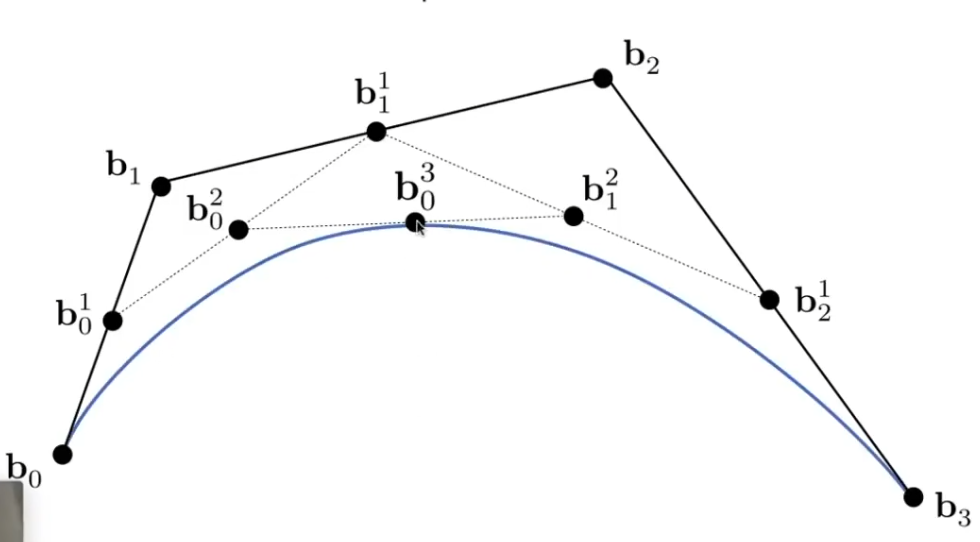

## 前言

[GAMES101-11](https://www.bilibili.com/video/BV1X7411F744/?p=11)：贝塞尔曲线与 B 样条

[GAMES101-12](https://www.bilibili.com/video/BV1X7411F744/?p=12)：贝塞尔曲线与 B 样条 <!-- more -->

## 贝塞尔曲线 Bézier Curve

贝塞尔曲线要求给定至少两个点，由首尾两个点决定始末，中间的点决定倾向（往哪里弯）。

给定 $n+1$ 个控制点 $b_0,\dots,b_n$，$n$ 次贝塞尔曲线的公式为：

$$b^n(t)= \sum^n_{j=0}b_jB^n_j(t),\qquad 0\leq t\leq1$$

其中：

$$
B_i^n(t)= C_n^it^i(1-t)^{n-i}=\binom{n}{i}t^i(1-t)^{n-i}
$$

其中 $t^i$ 前面的系数都是在表示组合数，$t$ 是曲线参数，从 $0$ 变到 $1$，点就从 $b_0$ 走到 $b_n$。最常用的三次贝塞尔曲线展开为：

$$b^3(t)=(1-t)^3b_0+3t(1-t)^2b_1+3t^2(1-t)b_2+t^3b_3$$

下面看这个公式是怎么来的。

德卡斯特里奥算法（de Casteljau's algorithm）有一种简单的递归画贝塞尔曲线的方法：

0. 假设我们依次有四个点 $b_0,b_1,b_2,b_3$，即三次贝塞尔曲线；一个点在曲线上运动，定义时间 $t=0$ 的时候在起点 $b_0$，$t=1$ 在终点 $b_3$。
1. 连接 $b_0,b_1,b_2,b_3$，找到三条连线上的 $t$ 位置，定义此点为 $b^1_0$、$b^1_1$、$b^1_2$；
2. 连接 $b^1_0$、$b^1_1$、$b^1_2$，继续找 $t$ 时刻位置得到 $b^2_0$、$b^2_1$；
3. 连接 $b^2_0$、$b^2_1$ 找 $t$ 位置的点 $P$（$b^3_0$）；
4. $P$ 就是时间 $t$ 时贝塞尔曲线上的点。

    

下面给出代数写法。

1. 对第一次递归的点可以写成形如 $b_0^1 = (1-t)b_0+tb_1$ 的形式；
2. 第二次递归的点等于 $b_0^2 = (1-t)b_0^1+tb_1^1=(1-t)^2b_0+2t(1-t)b_1+t^2b_2$，可以看到系数是二次项展开的形式；
3. 第 $n$ 次递归同理……

贝塞尔曲线的一些性质：

1. 曲线的起点是第一个给出点，终点是最后一个点；
2. 对于最常用的三次贝塞尔曲线，起点处切向量为 $b'(0)=3(b_1-b_0)$，终点处为 $b'(1)=3(b_3-b_2)$；
3. 对贝塞尔曲线仿射变换等于对点进行仿射变换再求其贝塞尔曲线；
4. 贝塞尔曲线一定在给定点的凸包内。

> 凸包：想象一个撑在几个钉子上的橡皮筋，橡皮筋围出的区域即钉子们的凸包。

### 分段贝塞尔曲线与连续

多次贝塞尔曲线存在的问题：多次贝塞尔曲线点对线的控制不够直观明显，很难体现具体一个点对曲线的影响。

因此，最常用的贝塞尔曲线是三次贝塞尔曲线，通过拼接多个贝塞尔曲线形成长曲线。这样一来，我们就需要考虑在拼接处的连续问题。要讨论两段曲线是否连续，我们先定义连续的概念：

- $G^0$（$C^0$）连续：两条曲线在该点首尾相连。
- $G^1$：在首尾相连的基础上，拼接点的切向量方向相同。
  - $C^1$：拼接点的切向量方向和大小均相同。对于两段三次贝塞尔曲线，若 $b_3=c_0$，还需要 $b_3-b_2=c_1-c_0$。
- $G^n$：可以通过改变参数化方式，使拼接处达到 $C^n$ 连续。
  - $C^n$：拼接点位置相同，从 $1$ 阶直到 $n$ 阶导数也分别相同。

其中 $C^i$ 叫参数连续，$G^i$ 叫几何连续。简单地说，$G^1$ 保证经过接头时不突然转向，$C^1$ 还要求按参数运动时速度也接得上。

## B 样条

样条：一条可控的曲线，分段定义的多项式参数曲线。

> 早期工程制图时，制图者将一段柔性的条板固定住，中间用一些钉子等工具迫使条板弯曲并固定来得到一条需要的曲线。这个条板就是样条。

B 样条是指基函数样条（basis spline）。B 样条是贝塞尔曲线的一种一般化，在贝塞尔曲线里基函数是伯恩斯坦多项式。B 样条有一些很好的性质，例如局部性：更改一个点不会影响到整条曲线而可以只修改其局部。

> 一个基函数空间里，所有的函数可以用基函数的线性组合表示。
>
> 伯恩斯坦多项式里，每一个项是一个基函数。

## 贝塞尔曲面

对于排列成 $(m+1)\times(n+1)$ 的控制点 $b_{ij}$，曲面上的点为：

$$S(u,v)=\sum_{i=0}^{m}\sum_{j=0}^{n}b_{ij}B_j^n(u)B_i^m(v),\qquad u,v\in[0,1]$$

其中 $B$ 就是上面贝塞尔曲线的基函数，$u,v$ 分别控制曲面的两个方向。

在两个方向都进行贝塞尔曲线，例如先对每一行控制点按参数 $u$ 求贝塞尔曲线上的点，再把这些点作为控制点，按参数 $v$ 求一次贝塞尔曲线。这样一组 $(u,v)$ 就能得到曲面上的一个点。

## 网格的几何处理

- 网格细分：网格拆分为更细的网格，并使模型变得更光滑；
- 网格简化：网格太细合为更大的网格；
- 网格正则化：让网格更接近“正”图形（如正三角形），减少网格的依赖。

### 网格细分

网格细分的两步操作：分出更多的网格、调整顶点位置使得模型更光滑。

#### Loop 细分

> 请注意这里的 Loop 是人名而非循环。

步骤：

1. 将一个三角形的中点连接，分成四个小三角形，这些中点是新的顶点；
2. 对于新顶点，其在两个三角形的公用边上。假定此边两个老顶点为 $A,B$，非此边上的老顶点为 $C,D$。那么新顶点的位置改为：$\frac{3}{8}(A+B)+\frac{1}{8}(C+D)$；
3. 对于老顶点，其是多个三角形的共用顶点。那么它的新位置为 $P'=(1-nu)P_0+u\sum P_i$，其中：
   1. $P_0$ 是该点原本坐标，$P_i$ 是与其通过一条边直接连接的点的坐标；
   2. $n$ 是该点的度，即有多少个边与之相连；
   3. 若 $n=3$，则 $u=\frac{3}{16}$，否则，$u=\frac{3}{8n}$。

> 上面的公式针对内部顶点。$n>3$ 时，周围点的总权重都是 $3/8$，点越多只是每个邻居分到的权重越小；边界点需要另外处理。

#### Catmull-Clark 细分

Catmull-Clark 可以对任意情况的网格使用而不局限于三角形网格。

定义奇异点：任何度不为 4 的顶点。

步骤：

1. 每个边的中点和每一个面的中点都是新的顶点，并且连接一个面内的边中点和面中点；

   > 经过这么一次细分以后，所有的非四边形面都不见了，而且同时会增加原本非四边形面那么多的奇异点。
2. 对于内部的点：
    - 面中点：这个面所有老顶点的平均。
    - 边中点：两个相连的老顶点和两个相邻面中点的平均。
    - 老顶点：设原位置为 $P$，相邻面中点的平均为 $F$，相邻老边中点的平均为 $R$，度为 $n$，那么新位置为 $\frac{F+2R+(n-3)P}{n}$。

### 网格简化

有时我们希望在保留整体大致形状的情况下减少面的数量降低运算的压力，就需要网格简化。一种网格简化算法是**边坍缩**。边坍缩即把一个边两边的点挪动到一起使得该边“坍缩消失”。为了解决哪些边应该坍缩、坍缩后的点应该在哪的问题，我们则需要使用到二次误差度量算法。

二次度量误差：坍缩后的点的位置是到原先相关平面的距离的平方和最小的位置。

于是算法的核心思想：维护一个优先队列存储每条边坍缩会带来的二次度量误差，依次坍缩带来误差小的边，并更新受影响的边的误差值。

> 这是一种贪心算法，但是整体的效果还是不错的。

## 跳转

Home：[GAMES101-1：课程总览与笔记导航](GAMES10101.html)

Prev：[GAMES101-10&11：隐式几何与显式几何](GAMES10109.html)

Next：[GAMES101-12&13：Whitted-Style 光线追踪（1）](GAMES10111.html)
