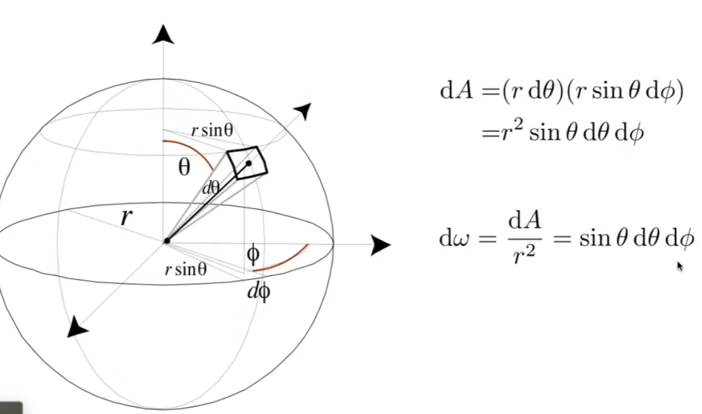
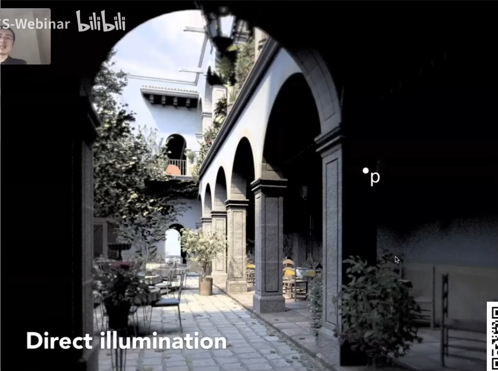
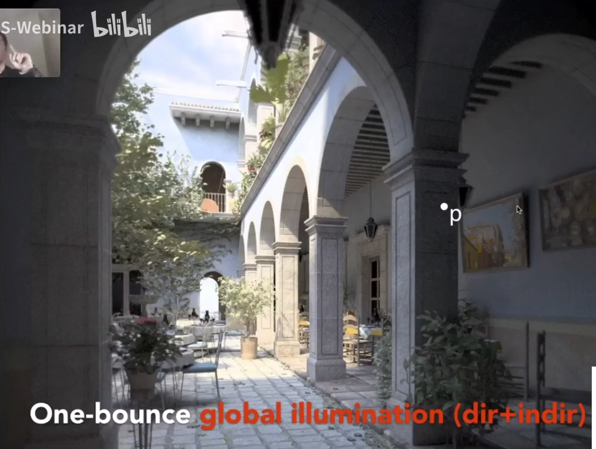
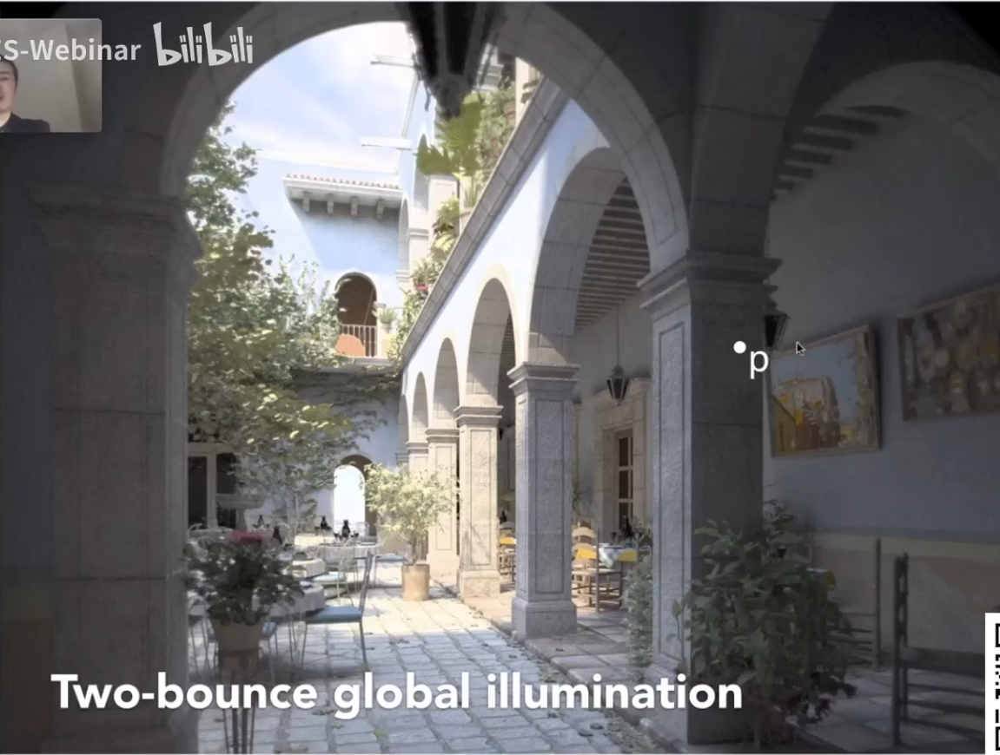
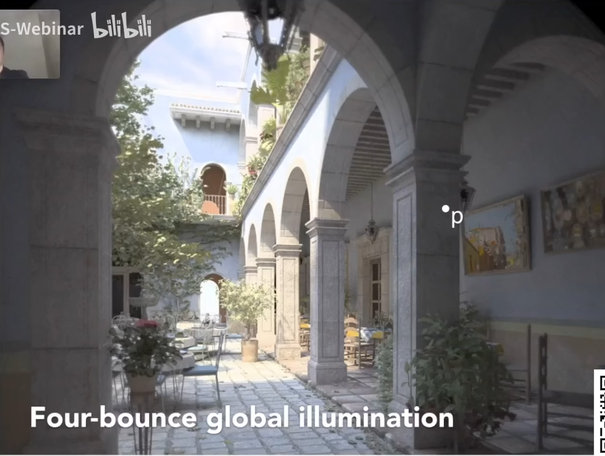

## 前言

[GAMES101-14](https://www.bilibili.com/video/BV1X7411F744/?p=14)：辐射度量学的意义、能量，功率与辐射强度（intensity）的定义。

[GAMES101-15](https://www.bilibili.com/video/BV1X7411F744/?p=15)：辐射度量学的基本概念：辐照度、辐亮度，BRDF，渲染方程，全局光照 <!-- more -->

## 辐射度量学

为什么要研究辐射度量学：Whitted-Style 光线追踪尽管可以在一些场景表现不错，但是其建立完全是基于经验值和表现的效果的，而不是实际的物理规律，因此其值不可能完全真实准确。这就是为什么我们需要辐射度量学。

要进行严谨度量，我们就要先定义单位（中文均为个人翻译，课程中没有中文名）：

- 辐射能 Radiant Energy：辐射出的能量 $Q$，单位 $\mathrm{J}$。
- 辐射通量/功率 Radiant Flux（power）：单位时间内辐射/吸收/反射的能量。对于光源即“有多亮”。$\Phi=\frac{\mathrm{d}Q}{\mathrm{d}t}$，单位 $\mathrm{W}$。
  > **注意**：下文和图形学中说到的能量往往是指 flux 而非 energy，因为我们总是在关心眼下发生的情况（实时）而非累计的结果。
- 辐射强度 Radiant Intensity：一个单位立体角的功率。 $I(\omega)=\frac{\mathrm{d}\Phi}{\mathrm{d}\omega}$，单位 $\mathrm{W/sr}$。
  
  类比弧度，立体角（Solid Angle）是指 $\Omega=\frac{S}{r^2}$，其中 $S$ 是球面上对应的面积，整个球面的立体角是 $4\pi$。用与 $y$ 轴（竖直轴）的夹角 $\theta$ 和绕竖直轴的方位角 $\phi$ 表示方向，一小块球面面积为 $\mathrm{d}S=r^2\sin\theta\mathrm{d}\theta\mathrm{d}\phi$，就有：

  $$\mathrm{d}\omega=\frac{\mathrm{d}S}{r^2}=\sin\theta\mathrm{d}\theta\mathrm{d}\phi$$
  
  

  如果一个点光源均匀地向所有方向辐射光，那么 Intensity 就简单地有：
  
  $$I=\frac{\Phi}{4\pi}$$

- 辐照度 Irradiance：单位面积接收到的功率（flux）。
  
  $$E(x)=\frac{\mathrm{d}\Phi(x)}{\mathrm{d}S}$$
  
  单位 $\mathrm{W/m^2}$。同样一束光斜着照到表面，会铺在更大的面积上，因此接收到的辐照度是正对光线时的 $\cos\theta$ 倍，$\theta$ 是光线与法线的夹角。这正是 Blinn-Phong 模型中应用的“物体接收到的光取决于与法线的余弦”（Lambert's Cosine Law）的物理意义。

  > 对于点光源，在没有吸收和遮挡时，同一方向的辐射强度 Intensity 不会随距离改变，但是辐照度 Irradiance 会按 $1/r^2$ 衰减。
- 辐亮度 Radiance：单位立体角、单位投影面积内的功率。换句话说，它既区分位置，也区分方向，投影面积为 $\mathrm{d}S\cos\theta$。
  
  $$L(p,\omega)=\frac{\mathrm{d^2}\Phi(p,\omega)}{\mathrm{d}\omega\mathrm{d}S\cos\theta}$$

  单位 $\mathrm{W/(m^2\cdot sr)}$。
  > 对来自所有方向的辐亮度乘上 $\cos\theta$ 再积分，就有该点的辐照度。再对面积积分，则有物体接收到的总功率。

这些概念中单位相对而言并不重要，请注意理解概念本身。不过 $\mathrm{lm,cd,lux,nit}$ 是按人眼敏感程度加权后的光度学单位，不能直接当成上面这些辐射度量单位。

## BRDF：双向反射分布函数

BRDF 的作用在于，将物体接收到的能量（Irradiance）和指定角度发出（反射）的能量（Radiance）联系了起来。对于一个极小区域 $\mathrm{d}A$，一束从 $\omega _i$ 入射的辐射是：

$$\mathrm{d}E(\omega_i)=L(\omega_i)\cos\theta_i\mathrm{d}\omega_i$$

物体把入射光反射到不同的方向，对于一个指定的方向 $\omega_r$，反射的能量记为 $\mathrm{d}L_r(\omega_r)$。

此时，可以记 BRDF 为：

$$f_r(\omega_i\rightarrow \omega_r)=\frac{\mathrm{d}L_r(\omega_r)}{\mathrm{d}E_i(\omega_i)}=\frac{\mathrm{d}L_r(\omega_r)}{L(\omega_i)\cos\theta_i\mathrm{d}\omega_i}$$

BRDF 的图像描述了辐射会被反射到哪个方向，例如如果是镜面反射，那么图像就是仅在镜面反射方向有值，其他方向没有多少值。

## 反射方程与渲染方程

把该点所有方向的入射光乘上 BRDF 和余弦后累加起来，就可以算出该点反射了多少光，即该点的**反射方程**：

$$L_r(p,\omega_r)=\int_{H^2}f_r(p,\omega_i\rightarrow \omega_r)L(p,\omega_i)\cos\theta_i\mathrm{d}\omega_i$$

添加自发光项使得公式对光源也适用：

$$
 L_o(p,\omega_o)=L_e(p,\omega_o)+\int_{H^2}L_i(p,\omega_i) f_r(p,\omega_i\rightarrow \omega_o) (\vec{n}\cdot\vec{\omega_i}) \mathrm{d}\omega_i
$$

此时方程就是**渲染方程**。需要指出的是涉及的向量的方向都是从 $p$ 点指向外的，而且通过积分域的限制，我们排除了下半球内的积分，这里讨论不透明表面的反射，不包含从背面透过来的光（相当于 Blinn-Phong 模型中的那个 $\max$）。而且通过积分，我们不仅可以处理多个点光源，也可以处理面光源。

## 全局光照

把上面的式子简单分析一下，其实就是：出射光 = 自发光 + 入射光对 BRDF 和余弦加权后的积分。其中未知量只有入射光和反射光。于是我们经过一系列的简化就可以有：

$$L=E+KL$$

其中 $L$ 表示整个场景的辐亮度，$E$ 是自发光，$K$ 包含反射、遮挡和几何关系。一个点的出射光会成为另一个点的入射光，所以右侧也由同一个 $L$ 决定。

把 $KL$ 移到左边，用 $I$ 表示单位算子；在多次反射的贡献逐渐衰减、级数收敛时，有：

$$
\begin{aligned}
L&=E+KL\\
&=(I-K)^{-1}E\\
&=E+KE+K^2E+K^3E+\dots
\end{aligned}
$$

其中，$E$ 即直接进入摄像机的自发光，$KE$ 即光源经过一次反射后进入摄像机的直接光照，$K^2E$ 即经过两次反射的间接光照，$K^3E$ 即经过三次反射的间接光照……依此类推。

光栅化可以较容易地处理前两项，但是很难处理后面的项。这也是为什么我们需要光线追踪。

将所有的光进行考虑得出的结果就是**全局光照**。下面给一些计算了不同次数反射的全局光照结果对比。

仅直接光：

增加一次间接弹射，直接光 + 间接光（$E+KE+K^2E$）：

增加两次间接弹射：

增加四次间接弹射：

随着次数的增加，新增弹射对效果的影响愈发小，结果也逐渐收敛。

需要注意的是，一次和二次光照的时候，屋顶的灯光反而变黑了，这是因为这里光两次折射还没有折出灯管，因此造成了错误。

最后说了一些概率论基础，没有特别需要记的必要。

## 跳转

Home：[GAMES101-1：课程总览与笔记导航](GAMES10101.html)

Prev：[GAMES101-14：Whitted-Style 光线追踪(2) 包围盒求交的速度优化](GAMES10112.html)

Next：[GAMES101-16：辐射度量学与路径追踪](GAMES10114.html)
