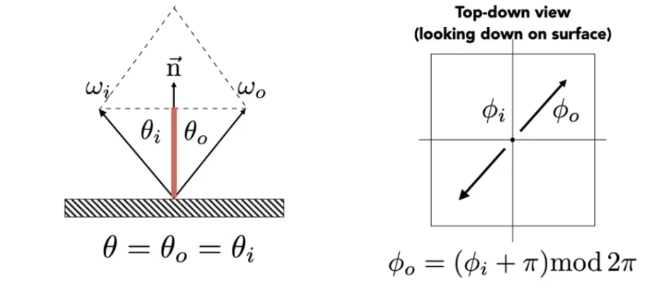

## 前言

[GAMES101-17](https://www.bilibili.com/video/BV1X7411F744/?p=17)：各种各样的材质、反射率、斯涅耳定律与全反射现象、菲涅尔项、微表面材质、BRDF 的特点与测量 <!-- more -->

## 材质就是 BRDF

我们现在已经知道，决定模型的光照效果是什么样的是不同的**材质**，而在我们的渲染方程（不考虑自发光）中，和物体自身相关的项只有 BRDF。这就是说，材质就是 BRDF。

 $$L_r(p,\omega_o)=\int_{H^2}L_i(p,\omega_i) f_r(p,\omega_i, \omega_o) (\vec{n}\cdot\vec{\omega_i}) \mathrm{d}\omega_i$$

> 材质决定物体的光照效果，具体来说，即反射/折射系数、金属质感强弱、光滑感、柔软度等等；
>
> 颜色纹理决定了表面不同位置的颜色，从物理上来说即对不同波长的光有不同的吸收程度，通常用一张图片通过 UV 坐标查询；
>
> 纹理和材质关系密切，因为纹理可以给 BRDF 提供参数。颜色、粗糙度、金属度等参数都可以用纹理记录。

材质多种多样，除了漫反射和镜面反射，这里还介绍两种情况。

- **抛光（Glossy）材质**：这种材质像打磨过的金属面，光被反射到一个小区间里，于是既有高光又不是完全的镜面。不同的金属的抛光面也有不同的质感，例如铜面发红，铝面发白。
- **折射**：半透明类型的材质还会同时发生反射和折射。折射的光与物体内的物体发生反射于是我们就可以看到物体内的物体。如果折射的过程中光被吸收了一部分，我们则就会看到发生折射的物体的颜色（例如水的绿色）。

### 漫反射与反射率

定义物体的**反射率（Albedo）** $\rho$ 衡量物体反射的强弱，值介于 $0$ 到 $1$ 之间。对于漫反射，反射率和 BRDF 之间的关系是：

$$
f_r = \frac{\rho}{\pi}
$$

也就是说，给出反射率，就可以得到用于渲染方程的漫反射 BRDF。下面看这个关系是怎么来的。

假设一个完全不吸收光（纯白）的物体表面发生漫反射，而且各个入射方向的 $L_i$ 相同。此时光均匀地从各个方向来，又被均匀地反射到各个方向去，就有 $L_o=L_i$。有：
$$\begin{aligned}
L_r(p,\omega_o)
    &=\int_{H^2}L_i f_r (\vec{n}\cdot\vec{\omega_i}) \mathrm{d}\omega_i  \\\\
    &= f_r L_i \int_{H^2}\cos\theta_i \mathrm{d}\omega_i    \\\\
    &= \pi f_r L_i \\\\
    &\Downarrow \\\\
f_r &= \frac{1}{\pi}
\end{aligned}
$$

而我们的情境就是物体反射率最强的时候，这时物体纯白，$\rho=1$。只反射其中 $\rho$ 的比例时，就得到 $f_r=\rho/\pi$。

*Albedo 的定义方式多种多样，既可以是一个数，也可以是 RGB 三个数或一张贴图。而 Albedo 纹理是一种特殊的纹理，它用于指定物体表面的颜色或基础反射率。*

## 反射和折射

此外，半透明类型的材质还会同时发生反射和折射。折射的具体效果见上。

类比于 BRDF，对于折射的“BRDF” 就是 BTDF，二者可以合称 BSDF。

### 反射

对于反射，我们知道入射角等于反射角。有两种计算反射方位的方式。

1. 利用向量的性质，入射向量加出射向量与法线向量共线（左图，这里的方向都从着色点向外，且均为单位向量）：
   $$
   \begin{aligned}
   \omega_i+\omega_o&=2\cos\theta\vec{n}=2(\omega_i\cdot\vec{n})\vec{n}\\
   \omega_o&=-\omega_i+2(\omega_i\cdot\vec{n})\vec{n}
   \end{aligned}
   $$
2. 类似在立体角处的讨论，把角度分成与法线方向的夹角 $\theta$ 以及垂直俯视法线方向的平面上的角 $\phi$ （右图），则 $\theta$ 不变，只需：
   $$\phi_o=(\phi_i+\pi)\mod2\pi$$

> 镜面反射还需要涉及到狄拉克 $\delta$ 函数，这里没有展开。

### 折射

斯涅耳定律（Snell's Law）指出，光从介质 $i$ 打到介质 $t$ 中，折射率与入射角、折射角（与法线的夹角）满足：
$$
\eta_i\sin\theta_i = \eta_t\sin\theta_t
$$

其中，真空的折射率为 1。而折射率越高，往法线方向（的负方向）偏移就越多。

> 折射在垂直于法线的平面上不改变光的方向。

如果要计算折射方向，记 $\eta=\eta_i/\eta_t$、$c_i=\omega_i\cdot\vec n$，则：

$$
\begin{aligned}
k&=1-\eta^2(1-c_i^2)\\
\omega_t&=-\eta\omega_i+(\eta c_i-\sqrt{k})\vec n
\end{aligned}
$$

这里 $\omega_i$ 仍从表面指向入射光来的方向，$\vec n$ 指向入射介质，两者都取单位向量；$\omega_t$ 从表面指向折射光前进的方向。$k\geq0$ 时可以计算折射方向，$k<0$ 时发生全反射，没有折射方向。

由斯涅耳定律推出：

$$\begin{aligned}
\cos\theta_t
    &=\sqrt{1-\sin^2 \theta_t}\\\\
    &=\sqrt{1-(\frac{\eta_i}{\eta_t})^2 (1 - \cos^2 \theta_i)}     \\\\
    &\Downarrow \\\\
    &1-(\frac{\eta_i}{\eta_t})^2 (1 - \cos^2 \theta_i) \geq 0
\end{aligned}
$$

这意味着当入射介质的折射率大于出射介质折射率的情况下，如果根号内小于 $0$，就不存在实数的折射方向，这就是全反射现象。临界角满足 $\sin\theta_c=\eta_t/\eta_i$，入射角大于临界角时发生全反射。

> Snell's Window
>
> 如果从水下看空气中的景物，整个水面上的世界会被压进一个有限的圆形区域。区域外对应的水下角度超过临界角，只能看到水下景物在水面的反射。这种情况就是 Snell's Window。

### 菲涅尔项

日常生活中可以观察到的现象：如果俯视一张光滑的桌子，几乎没有反光现象；如果接近平视，则反光现象明显。这说明，**物体的反射和透射的比例与光的入射角度有关**，这可以用菲涅尔项描述。

简单地说，菲涅尔项告诉我们：

1. 如果和法线方向夹角越大（最多 $90^\circ$，贴近平面），反射率越高，甚至于几乎全部反射掉；如果夹角越小，则反射率也越小，折射率不同的界面，正入射时的反射率通常也不为零。
2. 不同物体有不同的菲涅尔项。
3. 导体（金属）和绝缘体的菲涅尔项图像大不一样，主要体现在金属的最小反射率非常高，例如 0.9。

菲涅尔项的计算公式较为复杂，因此我们通常使用近似公式（施里克近似，Schlick's Approximation）：

$$
\begin{aligned}
R(\theta)&=R_0+(1-R_0)(1-\cos\theta)^5\\
R_0&=(\frac{n_1-n_2}{n_1+n_2})^2
\end{aligned}
$$

其中 $n_1,n_2$ 是界面两侧的折射率，$R_0$ 是正入射时的反射率。

> 拓展，导体的反射率还会发生随着角度增大而在一定区域内发生降低。此外，描述导体时要使用复折射率，其中的虚部与吸收有关。

### 微表面材质

从太空看地球我们可以发现这样一个事情，我们看不见地球表面的山川地貌，而看到的是阳光在地球表面的山川各种作用后的整体光照情况。

微表面理论告诉我们，离得够远，就看不到物体表面细节但是可以看到整体的光照情况。

于是微表面材质：

- 宏观：平坦但粗糙。
- 微观：崎岖的几何面且镜面反射，有自己的独立法线。

如果表面相对光滑，微表面反射的光集中在一个较小的区间，呈现抛光的效果；如果表面相对粗糙，微表面反射的光分散在一个较大的区间，呈现更宽、更模糊的高光。

微表面的 BRDF：

$$
f(i,o)=\frac{F(i,h)G(i,o,h)D(h)}{4(n,i)(n,o)}
$$

其中 $i,o,n$ 分别是入射方向、出射方向和表面法线，均取单位向量，方向从表面向外。这里考虑 $n\cdot i>0$、$n\cdot o>0$ 的反射：

- $h$：中间向量方向，即入射与出射方向的中间方向，$h=\frac{i+o}{\|i+o\|}$；
- $F$：菲涅尔项，告诉我们当前角度的反射率；
- $G$：几何项 / Shadowing-masking term，告诉我们有多少微表面的反射被另外一个微表面遮挡而损失了。这可以修正在接近水平面时的过亮情况；
- $D$：法线分布项，表示有多少微表面的法线朝向 $h$，这些微表面才会把光从 $i$ 反射到 $o$。

分母中的 $(n,i)$ 和 $(n,o)$ 表示点乘。

## 各向同性材质与各向异性

- 各向同性：微表面没有非常明确的方向性；或者从 BRDF 的方向来说，入射角和出射角的方位角变化，但是相对角度不变，则光照效果不变。
- 各向异性：微表面有非常明确的方向性；从 BRDF 的方向来说，入射角和出射角的方位角变化，但是相对角度不变，光照效果会变。

> 各向异性的一个例子，沿一个表面刷过的金属器皿有条状/辐射状的高光。

这里的各向异性和我们前面提到的各向异性过滤是一样的内涵。

## BRDF 的特性

总结 BRDF 的特点：

- 非负性：能量的分布当然不可能是负数。
- 线性：我们可以把 BRDF 拆分计算再相加（例如组合漫反射项和高光项）。
- 可逆性：交换入射、出射方向，结果不变。
- 能量守恒：反射出去的能量不能比入射的多，即 $\int_{H^2}f_r(\omega_i,\omega_o)\cos\theta_o\mathrm{d}\omega_o\leq1$。
- 如果各向同性，BRDF 只有三个维度（$\theta_i,\theta_o,\phi_i-\phi_o$），而不是四个。因为绕法线同时旋转入射、出射方向，不会改变反射结果。

## BRDF 的测量

实际上的 BRDF 非常复杂，所以我们可以（要）测量 BRDF，而不是（不能）仅简单使用公式。

测量方法：可以枚举所有的光照方向和观察方向。

当然，如果各向同性可以砍一个维度。

> 拓展：MERL BRDF Database

## 跳转

Home：[GAMES101-1：课程总览与笔记导航](GAMES10101.html)

Prev：[GAMES101-16：辐射度量学与路径追踪](GAMES10114.html)

Next：[GAMES101-18：渲染中的高级板块](GAMES10116.html)
