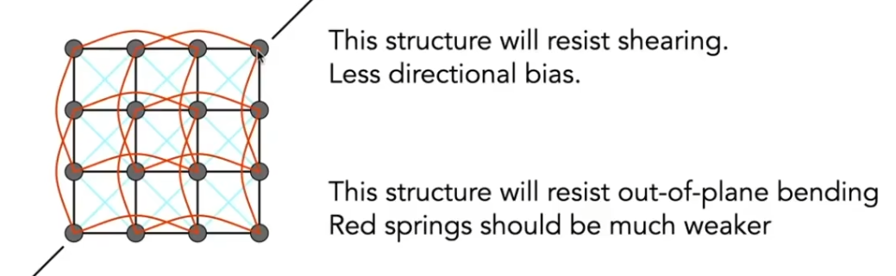

## 前言

[GAMES101-21](https://www.bilibili.com/video/BV1X7411F744/?p=21)：动画的历史、关键帧、物理模拟、刚体、正向与逆向运动学、Rigging、动捕 <!-- more -->

## 动画

动画：给物体带来生命，一种交流工具。在计算机时代，我们可以认为动画就是不断连续输出模型随时间的变化的帧。

### 动画的历史

1963 年，就有了计算机动画：Sketchpad 中的动画。

Pixar 的《玩具总动员》是一个里程碑式的作品：整个全长电影都是计算机渲染出来的。

### 关键帧

这个关键帧就是 PR 等中的**关键帧**。

以前的艺术家，会画出关键帧，然后由助手画中间的帧。

现在，我们希望计算机可以插值出中间的帧。当然，插值有许多的方式，不一定是线性插值。我们还可以期待例如 $C^1$ 连续的插值等。

### 基于物理的动画（物理模拟）

如果例如我们给出正确的力学公式和正确的力学模型，当然就可以更新模型的动作变化，即物理模拟。

其中很重要也很困难的一部分是流体模拟。

质点弹簧系统（Mass Spring System）：通过一系列的质点和连接的弹簧来进行模拟。

在 $a,b$ 两个质点之间用自然长度为 $l$ 的弹簧连接。弹簧现在被拉开，因此 $a$ 受到指向 $b$ 的力，应用胡克定律有：

$$
f_{a \rightarrow b} = k_s\frac{\vec{b}-\vec{a}}{\| \vec{b} - \vec{a} \|}(\| \vec{b} - \vec{a} \|-l)
$$

其中 $k_s$ 是弹簧的劲度系数，$f_{a\rightarrow b}$ 表示 $a$ 受到的弹力，$b$ 受到的弹力与它等大反向。

仅仅应用上面的模型是不够的，因为能量守恒，要让弹簧停下来我们就需要加入摩擦力。这里用阻尼力表示能量损失，有这么几点特点：

1. 它与 $a,b$ 之间的相对速度有关，而且是沿弹簧方向的相对速度。
2. 阻碍沿弹簧方向的相对运动。

基于此我们给出阻力公式（以 $b$ 为例）：

$$
f_b=-k_d\left[(\boldsymbol{\dot{b}}-\boldsymbol{\dot{a}})\cdot\frac{\vec{b}-\vec{a}}{\|\vec{b}-\vec{a}\|}\right]\frac{\vec{b}-\vec{a}}{\|\vec{b}-\vec{a}\|}
$$

其中 $k_d$ 是阻力系数，$\boldsymbol{\dot{b}}-\boldsymbol{\dot{a}}$ 中一个点表示一阶导，即质点的速度。这里 $f_b$ 只表示 $b$ 受到的阻尼力，$a$ 受到的阻尼力与它等大反向。

我们这么理解这个公式：$b$ 相对于 $a$ 的速度先与弹簧方向的单位向量点乘，得到沿弹簧方向的速度分量；再用这个数乘上单位向量，得到该方向的速度向量；最后乘以阻力系数并取反。无论弹簧正在伸长还是缩短，这个力都在阻碍相对运动。

把作用在同一个质点上的弹力、阻尼力和重力等相加，得到合力 $F$，再由 $\ddot x=F/m$ 得到加速度，$m$ 是该质点的质量。之后就可以更新速度和位置。

应用这些力学公式，我们将点之间用弹簧按方格的形式连接起来，似乎就可以简单地表示一块布了。但实际上还有一些问题：

- 不能抵抗切变：即如果沿一个方向拉，我们不应该能将布拉成一个没有宽度的线。为此，我们需要在对角线上连接上弹簧来抵抗切变。
- 不能抵抗非平面弯曲：即把布折起来时，应该有一点抵抗弯曲的力，而不是毫无阻力地折叠。为此，我们将一个点与和它上下左右隔了一个点的点连起来，提供一个很弱的力。

于是结构长这样：

> 切变可复习第三课的基本变换矩阵部分。

其他的模拟方法：

- 有限元方法 FEM：把物体拆成有限的小单元，在每个单元上近似位移、形变等量，再把单元之间的作用组合起来求解，适用于汽车碰撞等模拟。
- 粒子系统：用许多的粒子来模拟，粒子移动受一系列力的作用。这种方式的优点是易于理解、实现和规模可伸缩，挑战则是需要计算许多的粒子，计算需要考虑如何加速。  
  粒子的本质就是“描述个体与群体之间的关系”，因此实际上我们不仅仅可以用粒子来描述烟、雾、水等等，也可以用它来描述鸟群、蜜蜂、星系等等……例如，一个鸟“粒子”既会跟随鸟群中心移动方向移动，不希望离中心太远，也不会希望和其它鸟太近。

## 运动学（Kinematics）

### 正向运动学（Forward Kinematics）

骨骼系统：描述关节之间的拓扑关系，本身形成了一种树形结构。关节有三种类型：

- Pin：只能绕固定轴旋转（一个旋转自由度）。
- Ball：可以绕三个方向旋转（三个旋转自由度）。
- Prismatic：可以沿固定轴移动（一个平移自由度）。

正向运动学只要我们传入好每个关节的角度等参数，就可以告诉我们运动的结果，关节停在了哪儿。这种方式简单而直接，但是并不方便艺术家的使用：显然我们不希望调整关节的方式是不断地挨个输入角度看什么时候调得合适。为此我们需要逆运动学。

### 逆运动学

逆运动学即我们指定手、脚等末端要到达的位置，计算机反过来求关节角度，让末端尽量到达目标。

逆运动学的一些挑战：

- 计算会比正向运动学复杂很多。
- 多解情况：同一个手的位置，可能有不同的肘部姿势。
- 无解情况：目标超过手臂能伸到的范围，或者受到关节角度限制。

现在用的一些优化方法：用梯度下降的方法而非解数学公式。

## Rigging

Rigging 是对物体形状的控制，就如木偶上的提线，让角色做出不同的动作造型。

> Google Bard 将它翻译成了骨骼系统，不无道理可以参考但是骨骼感觉不能代表所有 Rigging。

这有些像三维世界的（贝塞尔）曲线调整，我们调节一些点使得样条变成我们想要的样子。

## 动作捕捉

干脆建立一个真人到虚拟人的控制点的映射，然后让人去做动作。

好处在于：真实度高、数据获取快（不用艺术家去一点一点调）；

缺点在于：准备工作非常多而复杂（例如穿控制点的衣服等等）、不一定能获取到需要的数据（非真实风的、控制点难以捕捉的）。控制点有很多办法来记录，例如穿绿幕衣服用摄像机 + CV 算法的方式，或者连接机器等等。

《阿凡达》的里程碑效应在于，其大量使用了面捕技术。

动画的生产管线：原画->模型->生产吧啦吧啦……

## 跳转

Home：[GAMES101-1：课程总览与笔记导航](GAMES10101.html)

Prev：[GAMES101-20：颜色与感知](GAMES10118.html)

Next：[GAMES101-22：动画2](GAMES10120.html)
