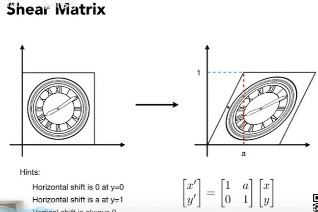

## 前言

[GAMES101-P3](https://www.bilibili.com/video/BV1X7411F744?p=3)：基本线性变换（旋转、缩放、切变）和平移、仿射变换矩阵、齐次坐标、三维变换中的旋转问题。 <!-- more -->

对图形进行各种变换，可以相当于对其左乘对应矩阵。

## 基本线性变换

1. 缩放矩阵：
   $\begin{bmatrix}
    s_x & 0\\
    0 & s_y
    \end{bmatrix}$

2. 切变（Shear）矩阵：
   $\begin{bmatrix}
  1 & a\\
  0 & 1
  \end{bmatrix}$

    切变的本质就是将矩形变成平行四边形。坐标不变的轴称之为**依赖轴**，发生变换的轴称之为**方向轴**。这里 $x'=x+ay$、$y'=y$。下图为一个 $y$ 为依赖轴的例子：

3. 旋转：旋转点通常是原点，逆时针旋转 $\theta$ 的矩阵为：$\begin{bmatrix}
  \cos\theta & -\sin\theta \\
  \sin\theta & \cos\theta
\end{bmatrix}$

   对旋转矩阵，其反方向旋转的对应矩阵为其逆矩阵同时也是转置矩阵。

## 齐次坐标和仿射变换

使用 $n+1$ 维坐标表示 $n$ 维坐标。其中，对于二维的**点**，记为 $(x,y,1)^T$，对于**向量**，记为 $(x,y,0)^T$。点的最后一维如果是 $w$，则前两维都除以 $w$ 得到普通坐标（$w\neq 0$）。

由于平移不能写成原来的二维矩阵左乘形式进而与其余变换统一，所以我们引入齐次坐标，使得平移矩阵为：
$\begin{bmatrix}
  1 & 0 & t_x \\
  0 & 1 & t_y \\
  0 & 0 & 1
\end{bmatrix}$

> 思考：为什么向量和点的第三维不一样？
>
> 对于向量，具有平移不变性，我们不希望其左乘平移矩阵得到的结果是新的向量，对于点的想法则相反。因此向量的最后一维应为 0，使得其不受平移矩阵影响。
>
> 进一步地，有：
>
> - 向量 + 向量 = 向量。
> - 向量 + 点   = 点。
> - 点   - 点   = 向量。
> - 点   + 点   = 二者中点：最后一维变成 2，除回 1 时，前面的坐标也都除以 2。
> - ……
>
> 可以发现向量为 0 而点为 1 的情况对于上述现象也可以解释得很好。

### 仿射变换

定义**仿射变换**：仿射变换 = 线性变换 + 平移。

使用齐次坐标可以表示仿射变换。仿射变换矩阵等于多个线性变换矩阵、平移变换矩阵相乘后的结果。

$$M=\begin{bmatrix}
  a & b & t_x \\
  c & d & t_y \\
  0 & 0 & 1
\end{bmatrix}$$

其中 $a,b,c,d$ 表示旋转、缩放、切变，$t_x,t_y$ 表示平移。

### 逆矩阵

对于可逆的仿射变换矩阵 $M$，定义逆矩阵：

$$MM^{-1} = E$$

其中 $E$ 为单位矩阵。

$M$ 的逆矩阵恰好对应原来仿射变换的逆变换。

特别地，对于旋转变换，其逆矩阵和转置矩阵相同，使得求其逆变换变得方便。逆矩阵等于转置矩阵的矩阵被称为**正交矩阵**。

> 矩阵不满足交换律，变换也不满足交换律。变换的顺序很重要。

## 绕任意点的旋转

设任意旋转点为 $P$，将旋转分解为：把整个图形平移，使 $P$ 回到原点、旋转 $\alpha$ 角、反向平移，使原点回到 $P$ 点。

于是有变换矩阵：

$$T = T(P)R(\alpha)T(-P)$$

（$T(P)$ 表示平移，$R(\alpha)$ 表示旋转。注意顺序是由右到左表示的。）

## 三维变换

对于三维变换，可以简单地写出缩放和平移，重点关注旋转。

在二维的基础上多加一个 $z$ 分量，点的齐次坐标为 $(x,y,z,1)^T$，向量为 $(x,y,z,0)^T$，变换矩阵也就变成了 $4\times4$。

缩放和平移矩阵分别为：

$$S=\begin{bmatrix}
  s_x & 0   & 0   & 0 \\
  0   & s_y & 0   & 0 \\
  0   & 0   & s_z & 0 \\
  0   & 0   & 0   & 1
\end{bmatrix}
$$
$$T=\begin{bmatrix}
  1 & 0 & 0 & t_x \\
  0 & 1 & 0 & t_y \\
  0 & 0 & 1 & t_z \\
  0 & 0 & 0 & 1
\end{bmatrix}
$$

左乘点坐标，缩放后得到 $(s_xx,s_yy,s_zz,1)^T$，平移后得到 $(x+t_x,y+t_y,z+t_z,1)^T$，也就是分别处理三个方向。

### 绕轴旋转

考虑简单的旋转：绕一个轴在一个平面内旋转，矩阵如下：

$$R_x=\begin{bmatrix}
  1 & 0         & 0          & 0 \\
  0 & \cos\alpha & -\sin\alpha & 0 \\
  0 & \sin\alpha & \cos\alpha  & 0 \\
  0 & 0         & 0          & 1
\end{bmatrix}
$$
$$
R_y=\begin{bmatrix}
  \cos\alpha  & 0 & \sin\alpha  & 0 \\
  0          & 1 & 0          & 0 \\
  -\sin\alpha & 0 & \cos\alpha  & 0 \\
  0          & 0 & 0          & 1
\end{bmatrix}
$$
$$
R_z=\begin{bmatrix}
  \cos\alpha & -\sin\alpha & 0 & 0 \\
  \sin\alpha & \cos\alpha  & 0 & 0\\
  0         &  0         & 1 & 0 \\
  0         & 0          & 0 & 1
\end{bmatrix}  
$$

**请注意 $y$ 轴中 $\sin\alpha$ 的正负号与其他情况不同**。

这是因为旋转矩阵的循环对称性。即 $xyzxyz$ 的循环中，前两个轴叉乘得到第三个轴。所以对 $R_y$ 有 $\vec z\times\vec x=\vec y$ 而非相反。

### 绕任意轴旋转

对于任意角度的绕原点旋转，可以把它分解为绕三个坐标轴的旋转（这三个角度称为**欧拉角**），变成三个轴的变换矩阵的乘积。

对绕任意过原点的轴 $n$ 旋转 $\alpha$ 角，$n$ 为单位向量，有 Rodrigues' Rotation Formula 如下：
$$
\mathbf{R}(\mathbf{n},\alpha) = \cos(\alpha)\mathbf{I}+(1-\cos(\alpha))\mathbf{n}\mathbf{n}^T+\sin(\alpha)\mathbf{N}
$$
其中：
$$
\mathbf{N}=\begin{bmatrix}
  0 & -n_z & n_y \\
  n_z & 0 & -n_x \\
  -n_y & n_x & 0
\end{bmatrix}
$$

其中，称 $\mathbf{N}$ 为 $n$ 的反对称矩阵，也就是向量 $n$ 的叉积的矩阵形式：$\mathbf{N}\vec a=\vec n\times\vec a$。

对于**任意不过原点的旋转**，把其分解为平移使旋转轴经过原点、旋转、平移回去的过程。

引入四元数是为了更好地对旋转进行插值，关于四元数，另行参考。

## 跳转

Home：[GAMES101-1：课程总览与笔记导航](GAMES10101.html)

Prev：[GAMES101-2：回顾线代](GAMES10102.html)

Next：[GAMES101-4：视图和投影变换](GAMES10104.html)
