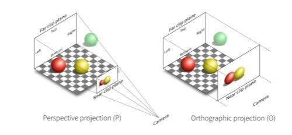
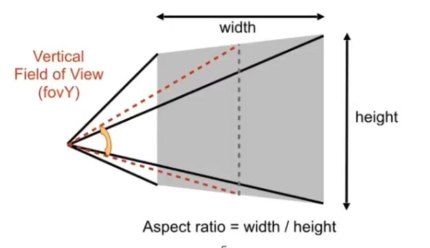
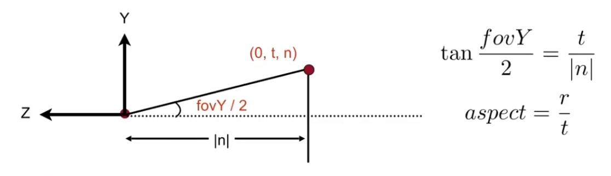
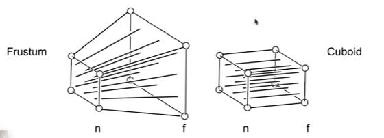
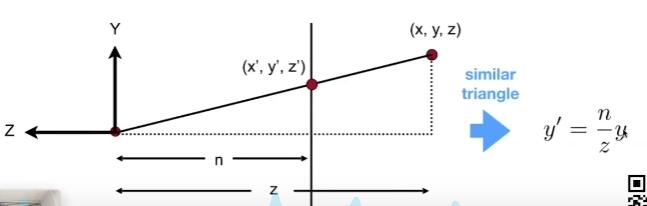

## 前言

[GAMES101-P4](https://www.bilibili.com/video/BV1X7411F744?p=4)：视图变换和投影变换（正交投影、透视投影）。透视投影部分内容在原视频 [P5](https://www.bilibili.com/video/BV1X7411F744?p=5)。<!-- more -->

> 如何拍一张照片：MVP 变换
>
> Model Transformation：摆好位置。
>
> View Transformation：找好拍照角度。
>
> Projection Transformation：拍照。

## 视图变换：View

思考：任何情况下进行拍照，照片都只和物体相对于相机的坐标有关。

所以建立一个新的坐标系（相机坐标系），规定：

- 相机处于原点；
- 相机的向上方向是 $Y$（up at $Y$）；
- 相机看向 $-Z$ 方向。

相机在世界坐标中的位置记为 $e=(e_x,e_y,e_z)^T$，右、上、后三个互相垂直的单位方向分别记为 $\vec r,\vec u,\vec b$。视图变换矩阵为：

$$
M_{view}=\begin{bmatrix}
  r_x & r_y & r_z & -\vec r\cdot e \\
  u_x & u_y & u_z & -\vec u\cdot e \\
  b_x & b_y & b_z & -\vec b\cdot e \\
  0 & 0 & 0 & 1
\end{bmatrix}
$$

使用时，$p_{view}=M_{view}p_{world}$，两边的点都用四维齐次坐标表示，也就是把世界坐标转换到相机坐标。

将坐标转换：

- 平移相机至原点；
- 旋转使向上方向为 $Y$，旋转使相机看向的方向为 $-Z$。

求此处旋转矩阵，可以求坐标轴旋转为相机轴的旋转矩阵，然后转置。把 $\vec r,\vec u,\vec b$ 作为列，先组成 $3\times3$ 的旋转矩阵，再按齐次坐标补成 $4\times4$ 的矩阵，记为 $R$。它表示把世界坐标轴转到相机的三个方向，$R^T$ 则把这三个方向转回来。

$T(-e)$ 表示沿 $-e$ 平移的矩阵，也就是把每个点的坐标变为 $(x-e_x,y-e_y,z-e_z)$。于是 $M_{view}=R^TT(-e)$：先让相机回到原点，再把它的三个方向转回坐标轴，场景中的物体也一起变换。

## 投影变换：Projection

两种投影方式：

1. Orthographic Projection：正交投影。
2. Perspective Projection：透视投影。

透视投影更接近人眼成像，会有“近大远小”、“不平行于成像面的平行线相交于一点”等效果。

在如下图所示的模型中，透视事实上就是拍下了锥形视野内近、远平面之间的物体，正交则是相机处于无限远处的一个特例。

### 正交投影

- 构建相机坐标系；
- 构建一个包含所有物体的空间长方体，描述它为 $[l,r]\times[b,t]\times[f,n]$（左右下上远近）。这里深度由远及近，是由于右手坐标系且看向 $-Z$ 方向，远处 $Z$ 坐标更小，即 $f<n<0$。
- 将结果规范化在一个 $[-1,1]^3$ 的方块内。

完整矩阵为：

$$
M_z=\begin{bmatrix}
  \frac{2}{r-l} & 0 & 0 & -\frac{r+l}{r-l} \\
  0 & \frac{2}{t-b} & 0 & -\frac{t+b}{t-b} \\
  0 & 0 & \frac{2}{n-f} & -\frac{n+f}{n-f} \\
  0 & 0 & 0 & 1
\end{bmatrix}
$$

左乘相机空间中的点 $(x,y,z,1)^T$，就得到标准化设备坐标（NDC）的齐次形式，最后一维仍为 $1$。左右边界分别变为 $-1,+1$，下上边界分别变为 $-1,+1$，远平面 $f$ 变为 $-1$，近平面 $n$ 变为 $+1$。

这个矩阵可以分解为：中心移至原点，再缩放：
$$
M_z=\begin{bmatrix}
  \frac{2}{r-l} & 0             & 0             & 0 \\
  0             & \frac{2}{t-b} & 0             & 0\\
  0             &  0            & \frac{2}{n-f} & 0 \\
  0             & 0             & 0             & 1
\end{bmatrix}  \times
\begin{bmatrix}
  1 & 0 & 0 & -\frac{r+l}{2} \\
  0 & 1 & 0 & -\frac{b+t}{2}\\
  0 & 0 & 1 & -\frac{n+f}{2} \\
  0 & 0 & 0 & 1
\end{bmatrix}
$$

### 透视投影

#### 透视投影的变换矩阵

相机位于原点，朝 $-Z$ 方向看。近平面的范围为 $[l,r]\times[b,t]$（左右下上），近、远平面分别位于 $z=n$、$z=f$，有 $f<n<0$。与正交投影一致，近、远平面的标准化设备坐标（NDC）深度分别为 $+1,-1$。完整的投影矩阵为：

$$
P=\begin{bmatrix}
  \frac{2n}{r-l} & 0 & -\frac{r+l}{r-l} & 0 \\
  0 & \frac{2n}{t-b} & -\frac{t+b}{t-b} & 0 \\
  0 & 0 & \frac{n+f}{n-f} & -\frac{2nf}{n-f} \\
  0 & 0 & 1 & 0
\end{bmatrix}
$$

对视锥内的一个点，先用矩阵 $P$ 变换它在相机空间中的齐次坐标，再把前三维除以第四维（透视除法）：

$$
\begin{aligned}
  (x_c,y_c,z_c,w_c)^T &= P(x,y,z,1)^T \\
  (x_{ndc},y_{ndc},z_{ndc})^T &= (x_c/w_c,y_c/w_c,z_c/w_c)^T
\end{aligned}
$$

第一步得到的仍是四维齐次坐标，第二步才得到 NDC。之后的视口变换再把 $x,y$ 变成屏幕上的像素坐标。

这样就可以逐行理解了：

- 前两行与透视除法一起，把投影到近平面后的 $nx/z,ny/z$ 平移、缩放到 $[-1,1]^2$。对于左右、上下对称的视锥，同样的 $x,y$，离相机越远，$-z$ 越大，结果越靠近画面中心，也就是近大远小。
- 第三行与透视除法一起，把 $z=n$ 映射到 $+1$，把 $z=f$ 映射到 $-1$。中间的深度由同一个式子确定，用来比较物体的远近。
- 第四行得到 $w=z$，供后面的透视除法使用。

> 与后面的深度检测联系起来：第 5 篇的视口变换只处理 $x,y$，保留 NDC 深度。如果再用 $d=(1-z_{ndc})/2$ 把这里的深度映射到 $[0,1]$，近端为 $0$，远端为 $1$，就可以按第 6(2) 篇中“越小越近”的方式比较。这只是统一深度的范围，其中的 $1/z$ 关系仍然保留。

#### 近平面的表示方法：可视角度

我们通常认定近、远平面的深度（$z$ 轴）是已知的，所以现在的问题是如何描述近平面：

1. 指定近平面四个点的坐标。
2. 指定宽高比和可视角度。下图为 $y$ 轴可视角度的表示，根据 $y$ 轴可视角度和宽高比可以求出 $x$ 轴的可视角度。
   

   两种表示是可以互相转换的，如下：

   

   其中 $\mathrm{fovY}$ 为竖直可视角度，aspect 为宽高比。对于左右、上下对称的视锥，近平面的范围为 $[-r,r]\times[-t,t]$。用半个可视角度构成直角三角形，有 $t=|n|\tan(\mathrm{fovY}/2)$，再由宽高比得到 $r=\mathrm{aspect}\cdot t$。

#### 透视投影的推导

对如上图的透视，近平面位于 $z=n$，远平面位于 $z=f$，有 $f<n<0$。这里的 $l,r,b,t$ 描述近平面的范围，有：

- 近平面保持不变，其余地方进行“挤压”使得其与近平面一样大。使上图左侧变成右侧形状。
- 进行正交投影。

这里有一个需要注意的地方是，挤压以后，**坐标的 $Z$ 轴值“可能”会发生变化**。

> 为了得到 $x'=nx/z$、$y'=ny/z$，我们把齐次坐标的第四维设为 $z$，还原时三个坐标都要除以 $z$。如果还要求深度处处保持原来的 $z$，相除前的第三维就要是 $z^2$，而固定矩阵乘法得到的是坐标的一次组合。所以这里保留近、远平面的深度，中间的深度则会重新分布。
>
> 这里可能还需要结合后面的推导进一步理解。

对此我们规定：

- $n$ 平面上的坐标不变；
- $f$ 平面上的 $Z$ 坐标不变，且平面中点坐标不变。

对于任意的点 $(x,y,z)$，先按投影到 $n$ 平面的比例求 $x',y'$，$z'$ 另算。相似三角形有：

$$\begin{align}
     y' =\frac{n}{z}y\\
x'=\frac{n}{z}x
\end{align}$$

接下来求解 $Z$ 轴的变换方程，即矩阵的第三行。

假设变换矩阵为 $M$，有：

$$M(x,y,z,1)^T=(nx,ny,z_2,z)^T\sim(\frac{n}{z}x,\frac{n}{z}y,z_1,1)^T$$

其中 $z_1,z_2$ 未知，$z_1=z_2/z$。$\sim$ 表示同一个点的不同齐次坐标。

$z_2$ 的值由 $M$ 矩阵中的第三行决定，所以可以只关心第三行。又因为 $Z$ 坐标值显然和 $X,Y$ 没有关系，所以此行可以写为 $(0,0,A,B)$，其中 $A$、$B$ 未知。

$n$ 平面上的点满足变换矩阵且 $Z$ 坐标不变。所以 $n$ 平面上的坐标可以写成 $(x,y,n,1)^T$。同时乘以坐标 $n$，代表的点依然不变：$(nx,ny,n^2,n)^T$。

所以有 $(0,0,A,B)(x,y,n,1)^T=n^2$。

$f$ 平面同样，中点 $(0,0,f,1)^T$ 满足变换矩阵且 $Z$ 坐标不变。于是：

$$(0,0,A,B)(0,0,f,1)^T=f^2$$

于是可以联解：

$$\begin{align}
    An+B =n^2\\
    Af+B =f^2
\end{align}$$
得：
$$\begin{align}
    A = n+f\\
    B = -nf
\end{align}$$

所以解出 $Z$ 轴变换方程，$M$ 矩阵为：

$$M=\begin{bmatrix}
    n & 0 & 0   & 0 \\
    0 & n & 0   & 0 \\
    0 & 0 & n+f & -nf \\
    0 & 0 & 1   & 0
\end{bmatrix}$$

$M$ 只负责挤压。挤压后，视锥变成了范围为 $[l,r]\times[b,t]\times[f,n]$ 的长方体，所以接下来可以直接使用前面的正交投影矩阵 $M_z$。

把两个矩阵乘起来，完整的投影矩阵就是 $P=M_zM$，先挤压，再平移、缩放：

$$
P=\begin{bmatrix}
  \frac{2n}{r-l} & 0 & -\frac{r+l}{r-l} & 0 \\
  0 & \frac{2n}{t-b} & -\frac{t+b}{t-b} & 0 \\
  0 & 0 & \frac{n+f}{n-f} & -\frac{2nf}{n-f} \\
  0 & 0 & 1 & 0
\end{bmatrix}
$$

例如第三行，正交投影对 $z$ 的缩放系数是 $2/(n-f)$，平移量是 $-(n+f)/(n-f)$。乘上 $M$ 后，第三行第三项就是 $2(n+f)/(n-f)-(n+f)/(n-f)=(n+f)/(n-f)$，第四项就是 $-2nf/(n-f)$。

用 $P$ 左乘点 $(x,y,z,1)^T$，得到的仍是四维齐次坐标。把前三维除以第四维，才得到标准化设备坐标（NDC），视锥内的点落在 $[-1,1]^3$ 内。这个除法称为**透视除法**。这里第四维为 $z$，所以：

$$
\begin{aligned}
  x_{ndc} &= \frac{2nx}{(r-l)z}-\frac{r+l}{r-l} \\
  y_{ndc} &= \frac{2ny}{(t-b)z}-\frac{t+b}{t-b} \\
  z_{ndc} &= \frac{n+f}{n-f}-\frac{2nf}{(n-f)z}
\end{aligned}
$$

代入 $z=n$，有 $z_{ndc}=+1$；代入 $z=f$，有 $z_{ndc}=-1$，与前面正交投影的约定一致。挤压时保留近、远平面的 $z$，正交投影再把它们映射到这两个端点。

## 跳转

Home：[GAMES101-1：课程总览与笔记导航](GAMES10101.html)

Prev：[GAMES101-3：变换](GAMES10103.html)

Next：[GAMES101-5：(三角形的)光栅化](GAMES10105.html)
