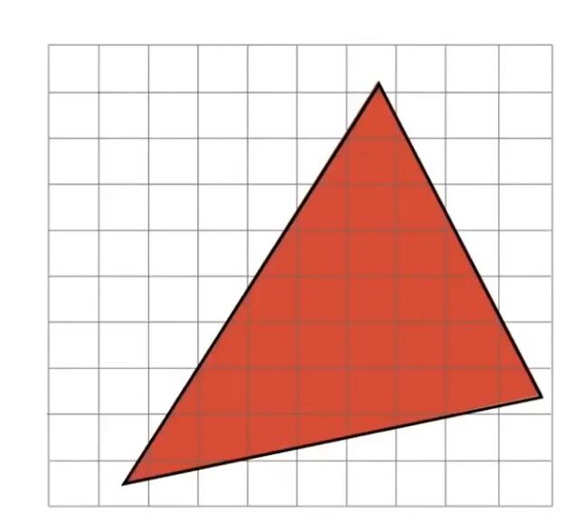

## 前言

[GAMES101-P5](https://www.bilibili.com/video/BV1X7411F744?p=5)：光栅化<!-- more -->

本节介绍 MVP 变换之后的操作：光栅化 Rasterize。

## 屏幕与光栅化

定义**屏幕**：

- 单元为像素的一个二维数组；
- 分辨率：长、宽方向的像素数；
- 是一种光栅成像设备。

**光栅化**：“画”到屏幕上。

**像素**：显示由 RGB 混合的单一色彩。

> pixel 是 picture element 的缩写。
>
> raster 其实是德语中的 screen 的意思。

**屏幕空间**：定义方式不一，可以以左下角为 $(0,0)$ 点，在第一象限定义空间。

### XY 方向的投影

将经历投影变换和透视除法得到的 $[-1,1]^2$ 的面拉成屏幕的宽高 $[0,w]\times[0,h]$，其中 $w,h$ 是屏幕的宽、高。变换矩阵：

$$
\begin{bmatrix}
  \frac{w}{2} & 0 & 0 &  \frac{w}{2} \\
  0 & \frac{h}{2}  & 0 & \frac{h}{2} \\
  0 & 0 & 1 & 0 \\
  0 & 0 & 0 & 1
\end{bmatrix}
$$

左乘 $(x_{ndc},y_{ndc},z_{ndc},1)^T$，就有 $x_{screen}=\frac{w}{2}(x_{ndc}+1)$、$y_{screen}=\frac{h}{2}(y_{ndc}+1)$。这里仅变换 $x,y$，$z$ 保持不变。像素 $(i,j)$ 的中心为 $(i+0.5,j+0.5)$，后面就用这个点判断是否落在三角形内。

## 三角形的光栅化

光栅化即将多边形劈成数个像素的过程，这个过程中最基础的是三角形。

三角形的良好性质：

- 最基础的多边形，而且其他多边形都可以拆分为三角形；
- 三角形定义的一定是平面（反例：沿对角线折了的四边形）；
- 清楚的内外定义：没有凹凸之分，通过叉积可以简单判断在里还是外；
- 三角形内点的属性可以根据与三角形顶点的重心坐标关系进行插值得到。

如何判断一个像素该不该被点亮？

## 采样

抽象地说，采样就是将一个函数离散化。

对像素中心进行采样：

- 如果像素中心在三角形内，则点亮，否则不点亮。
- 边界问题：如果落在边上，采取统一的处理方式，例如左下认、右上不认。共享边应只归属一个三角形，避免漏画或重复画。

> 判断点在三角形内：用三条边与点 $Q$ 的连线进行叉乘。
>
> 如 $\overrightarrow{P_0P_1}$、$\overrightarrow{P_1P_2}$、$\overrightarrow{P_2P_0}$ 分别对 $\overrightarrow{P_0Q}$、$\overrightarrow{P_1Q}$、$\overrightarrow{P_2Q}$ 叉乘，得到的结果都朝同一方向则说明在三角形内。

对判断过程进行加速：

> 包围盒方法：左于最左顶点、高于最高顶点的肯定不用考虑。取三个顶点的 $x,y$ 坐标各自的最小值和最大值，围成的矩形就是三角形的包围盒。
> 只遍历包围盒覆盖的像素，再用叉乘判断，不需要扫整张屏幕。

## Extend：关于显示设备

隔行扫描：交替扫描奇数行和偶数行。奇偶行来自不同的时刻，直接拼成一帧时，运动物体的边缘就可能错开，形成梳齿。

帧缓存（frame buffer）：将内存（显存）中的一块区域存储图像，并映射到屏幕。

画面撕裂：屏幕扫描到一半时切换了用于显示的帧缓存，上下部分就来自不同帧，运动物体在分界处错开。隔行扫描的梳齿发生在奇偶行之间，而这里的错位发生在两帧的分界处。

LCD：液晶显示。通过液晶过滤指定的波改变光的颜色。

LED：发光二极管。小灯管组合发光。

墨水屏：控制黑色墨水面显示在上还是白色墨水面显示在上，刷新极慢。

## 跳转

Home：[GAMES101-1：课程总览与笔记导航](GAMES10101.html)

Prev：[GAMES101-4：视图和投影变换](GAMES10104.html)

Next：[GAMES101-6(1)：反走样](GAMES1010601.html)
