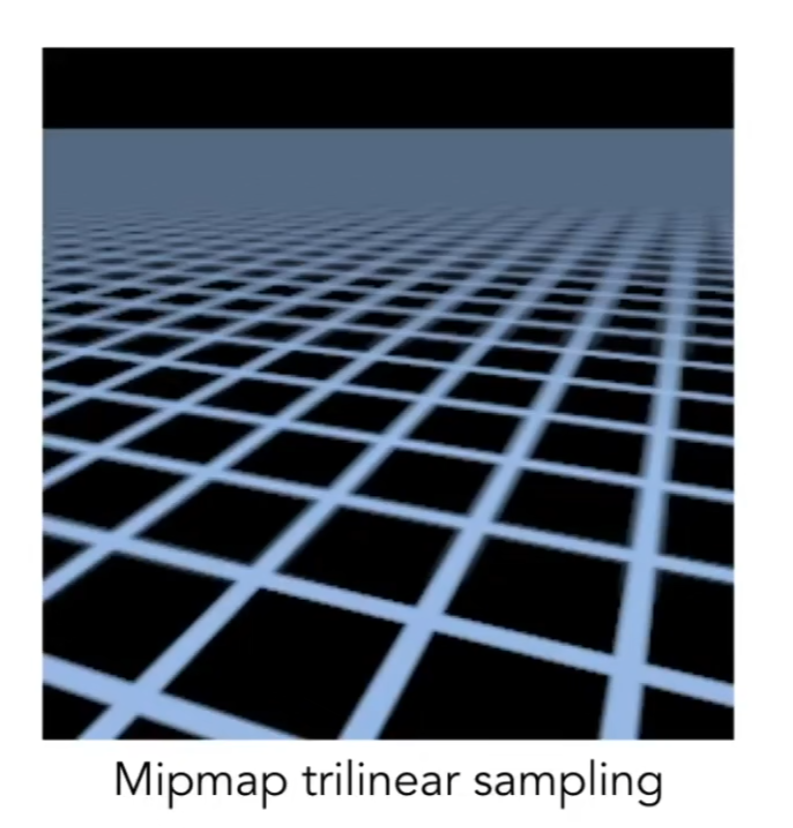
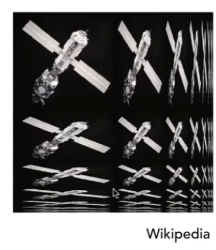

## 前言

[GAMES101-9](https://www.bilibili.com/video/BV1X7411F744/?p=9)：重心坐标、映射办法、纹理应用。

[GAMES101-10](https://www.bilibili.com/video/BV1X7411F744/?p=10)：纹理应用。 <!-- more -->

## 插值与重心坐标系

Gouraud 和 Phong 着色模型都要求在三角形内部插值，只是插值的属性不同，为了解决这个问题，我们应用重心坐标系。

对于任意三角形 $\triangle ABC$ 所在平面内点 $P$ 有：

$$\begin{aligned}P(x,y)&=\alpha A+\beta B+\gamma C\\\alpha+\beta+\gamma&=1\end{aligned}$$

**当点在三角形内，则 $\alpha\ \beta\ \gamma$ 均为非负数**。

这就是**重心坐标系**，通过重心坐标系，我们可以将三角形内的点坐标写成 $(\alpha,\beta,\gamma)$ 的形式。

已知 $P$ 点的坐标，求重心坐标的办法如下：

1. 连接 $PA,PB,PC$，把 $\triangle ABC$ 分成三个小三角形 $\triangle ABP$、$\triangle APC$、$\triangle PBC$。
2. 定义一个顶点对应的小三角形是与它不相邻的小三角形。如 $A$ 对应 $\triangle PBC$。
3. 定义原三角形面积为 $S$。
4. 由于三角形面积 $S=\frac{1}{2}l\cdot h=\frac{1}{2}|\vec{a}||\vec{b}|\sin\theta=\frac{1}{2}|\vec{a}\times \vec{b}|$，有：
   $$
   \begin{aligned}
   \alpha&=\frac{S_{\triangle A}}{S}=\frac{(\overrightarrow{BP}\times\overrightarrow{BC})_z}{(\overrightarrow{BA}\times\overrightarrow{BC})_z}\\
   \beta&=\frac{S_{\triangle B}}{S}=\frac{(\overrightarrow{AP}\times\overrightarrow{AC})_z}{(\overrightarrow{AB}\times\overrightarrow{AC})_z}\\
   \gamma&=\frac{S_{\triangle C}}{S}=1-\alpha-\beta
   \end{aligned}
   $$

这里把三角形放在 $xy$ 平面上，叉乘取 $z$ 分量。点在三角形内部时可以直接用面积比，外部则要保留符号。

> 当 $\alpha\ \beta\ \gamma$ 均为 $\frac{1}{3}$ 时，该点就是三角形的重心。重心将三角形分为三个面积相等的小三角形。

写成坐标就是：

$$\alpha=\frac{(y-y_B)(x_C-x_B)-(x-x_B)(y_C-y_B)}{(y_A-y_B)(x_C-x_B)-(x_A-x_B)(y_C-y_B)}$$

> 这个公式没啥记忆的必要，知道向量形式公式咋来就行。

此外还需要**注意**，由于重心坐标没有透视投影不变性，不能直接用投影后的重心坐标插值投影前的属性。假设屏幕空间中的重心坐标为 $\alpha,\beta,\gamma$，三个顶点投影后、齐次除法前的第四维为 $w_A,w_B,w_C$，那么属性 $q$ 的插值为：

$$q=\frac{\alpha q_A/w_A+\beta q_B/w_B+\gamma q_C/w_C}{\alpha/w_A+\beta/w_B+\gamma/w_C}$$

也就是先插值 $q/w$ 和 $1/w$，再把两者相除，这样在屏幕空间也能完成透视校正插值。

## 纹理映射

下面是一个简单的纹理映射逻辑：

1. 我们已经知道了每个顶点对应的 UV 坐标是什么。
2. 对于每个像素/屏幕采样点的坐标：
    1. 插值得到 UV 坐标。
    2. 查询 UV 坐标对应的值 `texcolor`。
    3. 像素的“颜色”（通常来说，漫反射系数）就设为 `texcolor`。

### 纹理放大带来的问题

如果纹理图片的分辨率较低，却要铺在较大的屏幕区域上，一个纹素就会对应多个屏幕像素，相当于放大了纹理。把归一化的 UV 坐标换算到纹素坐标以后，采样位置不一定落在纹素中心。此时查询纹理颜色，我们可以这么做：

1. 直接取最近的纹素：会导致多个连续像素对应同一个纹素（texel），导致马赛克。
2. 双线性插值：综合考虑周围四个纹素的远近关系进行插值，像素过渡更自然连续。
3. 双三次插值：综合考虑最近 16 个纹素的远近关系进行插值，像素过渡更自然连续，但是开销也比双线性更大。

### 纹理缩小带来的问题

反过来，如果纹理图片有很多纹素，却只映射到很小的屏幕区域，一个屏幕像素就会覆盖多个纹素。此时直接采样带来的结果和之前光栅化采样类似，采样过于稀疏，导致走样，产生摩尔纹、锯齿等现象。**超采样**能解决问题，但是开销巨大，其他的一些解决办法是：

#### Mipmap

Mipmap 可以进行快速、近似、方形的一个范围内的平均值查询。

Mipmap 的思路是，如果使用范围查询，快速查询像素对应区域内纹素的平均值，那么就不用只拿一个纹素代表整个区域，能减轻直接点采样带来的走样。

> 点查询即给定一个点查询对应点的值，范围查询则要求查询一个范围内的值，具体到此处是平均值。

Mipmap 会对每个图像不断构造分辨率变为原来 $\frac{1}{2}\times\frac{1}{2}$ 后的图像形成层级关系。例如第零层是原图 128×128，那么第一层是 64×64，第二层是 32×32……依此类推。通过数学可以简单地证明这样做带来的开销并不算很大，极限多占用额外的 $\frac{1}{3}$ 空间。

> Mipmap 也就是计算机视觉中的图像金字塔。

对于一个像素，我们求它与横向、纵向相邻像素映射到纹理上的距离，注意要换算成纹素数量。取两个距离中较大的一个作为正方形的边长 $L$，它对应的层级是 $D=\log_2L$，于是取该层 Mipmap 的值即可。$L\leq1$ 时用原图，不需要更小的层级。

如果求得层级是非整数，那么直接舍入会带来割裂感。我们可以使用插值的办法解决 1.8 层这样的问题。

**三线性插值**：在下舍的层级进行双线性插值；在上入的层级进行双线性插值，最后对两层结果进行线性插值。

Mipmap 并不是完美的，下图展示了由于 Mipmap 和三线性插值“平均”的特点导致远处过糊的问题。

#### 各向异性过滤

各向异性过滤考虑像素覆盖的纹理区域在不同方向上的长度。下图的 Ripmap 对 $x,y$ 方向分别压缩，可以查询长方形区域，比只用正方形更合适。不过这种轴对齐的长方形依然不能很好地表示斜向区域，实际的各向异性过滤还可以沿较长方向进行多次采样。

> 图中这种 Ripmap 额外占用的空间趋近于原图的三倍，而非三分之一。

## 纹理映射的应用

从 GPU 的角度看：纹理就是一段存在内存中的数据，GPU 可以对其进行点查询或范围查询。由此可以启发我们对纹理映射的应用。

- 环境光照/环境光映射：记录哪个位置有（直接/间接）光形成纹理图，映射以后就能得到一种类似镜子的、看到周围环境的效果。
- 环境光映射球/立方：我们可以用“一个绝对光滑的球”记录一个环境里所有的光照来源方向。
- 凹凸贴图：定义一个点相对于附近的点的高度，改变法线方向，从而得到橘子皮似的凹凸表现结果。
  首先计算出原来的法线（插值），再求高度在 $u,v$ 方向的偏导数，得到两个方向的倾斜程度，进而修改法线，也就是我们要的“假法线”。直接把法线方向存起来则是法线贴图。
- 位移（displacement）贴图：真的去偏移顶点而不是欺骗眼睛。
  凹凸贴图的缺点是图像的边缘不会真的变得凹凸出现错误，内部的假凹凸也不会在邻近区域产生阴影。
  但是位移贴图要求模型足够细，采样跟得上位移偏移的变化的频率。
- 3D 纹理：通过三维噪声生成纹理贴图，达到处处有贴图的效果，即使一个物体被劈开，内部依然可以得到对应的贴图。
- 预计算着色：把着色结果记录在纹理图中。例如眉毛下对眼睛产生的阴影，规避一些影子计算的问题。

## 跳转

Home：[GAMES101-1：课程总览与笔记导航](GAMES10101.html)

Prev：[GAMES101-7&8：着色、纹理与图形管线](GAMES10107.html)

Next：[GAMES101-10&11：隐式几何与显式几何](GAMES10109.html)
