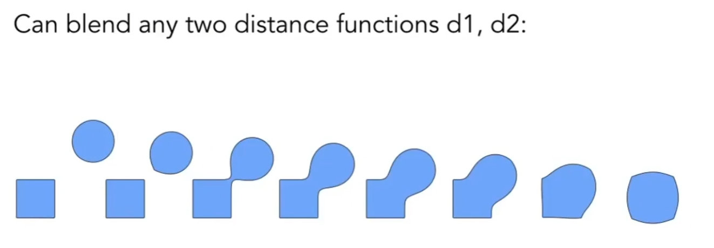

## 前言

[GAMES101-10](https://www.bilibili.com/video/BV1X7411F744/?p=10)：隐式几何   <!-- more -->
[GAMES101-11](https://www.bilibili.com/video/BV1X7411F744/?p=11)：显式几何

用三角形面并不能很好地面对所有的情形，例如：庞大的城市如何简化远景、狗身上繁复细密的毛发、轻薄半透的纱衣……

CG 中将几何分为隐式几何与显式几何。下面分别讨论。

## 隐式几何

隐式几何：不指明点的位置，但是指明点的关系。例如 $x^2+y^2+z^2=1$。更通用地，隐式几何指明 $f(x,y,z)=0$。

隐式几何很难找出满足条件的点都有哪些，但是很容易知道指定的一个点是否满足条件（在几何面上）。

在简单的几何情况下，我们容易写出 $f(x,y,z)$，但是几何体过于复杂时，直接写函数不太方便，我们可以采用**构造实体几何**（CSG）的办法：

构造实体几何：对基本的隐式几何体进行基本的布尔运算（交并补等）得到复杂的几何（参考工图作业图）。

此外对于隐式几何我们还可以用**距离函数**：

距离函数：对任意一个点定义它到几何体表面的距离。如果再加上内外的符号，就是有符号距离函数，例如在面上距离为 $0$，面外为正，面内为负。

通过距离函数我们可以实现两个图形相融合的效果（空间中的点同时受到两个面的距离的拉扯），例如：

空间中的一个点到图形 $A,B$ 的有符号距离分别是 $a,b$，我们对两个值插值，得到 $(1-t)a+tb$。找出它等于 $0$ 的地方，就是混合后的新面。$t$ 从 $0$ 变到 $1$，图形也就从 $A$ 逐渐变为 $B$，不过中间的函数值不一定还是严格的距离。

为了表示复杂情况下函数值相同的点的集合，我们应用水平集这个概念，类似等高线。对于距离函数，$f(x,y,z)=0$ 是物体表面，其他取值就是离表面相同距离的点的集合。

如果把三维空间中的函数值存储为 3D 纹理，那么就可以从中找出函数值相同的点，得到对应的面。

隐式几何我们还可以很方便地表示**分形图形**。不断重复同样的构造规则，局部和整体就可能出现相似的形状。

## 显式几何

显式几何的定义方法是**直接给出**（例如前面章节提到的三角形面）或**参数映射**（例如每个 $(u,v)$ 都能映射到一个 $(x,y,z)$）。

相对地，显式几何难以判断点是否在几何面上。

显式几何的一些例子：

- 点云：用一堆点表示面，可以表示任何图形，通常会被转化成多边形面。
- 多边形面：用多个三角形面拼接成图形。
  - OBJ 格式：一种存储模型的格式，存储点和点的连接关系。`v` 记录顶点，`vt` 记录纹理坐标，`vn` 记录法线，`f` 用索引说明一个面由哪些顶点组成。

## 跳转

Home：[GAMES101-1：课程总览与笔记导航](GAMES10101.html)

Prev：[GAMES101-9&10：纹理映射的具体内容](GAMES10108.html)

Next：[GAMES101-11&12：曲线与面](GAMES10110.html)
